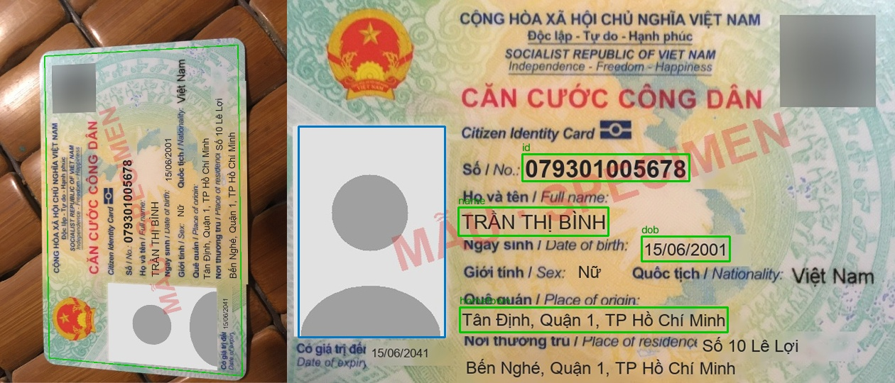
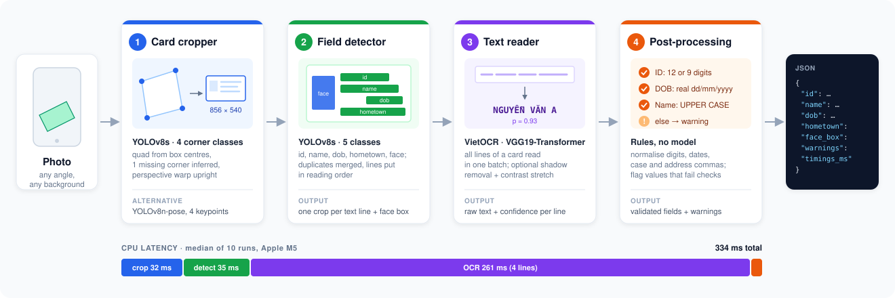

# eKYC – Vietnamese ID card information extraction

Read the front side of a Vietnamese citizen ID card (**CCCD**, chip-based, 2021 template) from a phone photo:
locate and flatten the card, find the text fields, read them with a Vietnamese OCR model and return validated JSON.

```text
$ ekyc examples/specimen_2.jpg
{
  "fields": {
    "id":       { "text": "079301005678", "confidence": 0.93, ... },
    "name":     { "text": "TRẦN THỊ BÌNH", ... },
    "dob":      { "text": "15/06/2001", ... },
    "hometown": { "text": "Tân Định, Quận 1, TP Hồ Chí Minh", ... }
  },
  "face_box": [7, 178, 223, 476],
  "card_quad": [[...], [...], [...], [...]],
  "warnings": [],
  "timings_ms": { "crop": 32.0, "detect": 34.8, "ocr": 261.2, "total": 334.1 }
}
```



> The sample cards in `examples/` are **fictitious specimens**: every personal detail (face, QR code, number,
> name, dates, addresses) was replaced with invented data. No real ID card is included in this repository.

## Pipeline

<p align="center"></p>

| Stage | Model | Size | Output |
|---|---|---|---|
| Cropper `corners` (default) | YOLOv8s detector, 4 classes (`top_left`, `top_right`, `bottom_right`, `bottom_left`) | 11.1 M params, 22 MB | card quad from the box centres; one missing corner is inferred |
| Cropper `keypoints` | YOLOv8n-pose, 1 class `paper` with 4 keypoints | 3.1 M params, 6 MB | document quad; trained on **A4 paper documents** (see below) |
| Field detector | YOLOv8s detector, 5 classes | 11.1 M params, 22 MB | one box per text line |
| Reader | [VietOCR](https://github.com/pbcquoc/vietocr) `vgg_transformer` | 152 MB | text + probability per line |

Post-processing normalises each field and adds a warning when a value fails validation:
the ID must have 12 digits (CCCD) or 9 digits (legacy CMND), the date of birth must be a real `dd/mm/yyyy` date,
names are upper-cased and addresses get consistent comma spacing.

### Two croppers, one pipeline

Only stage 1 differs between the two variants, so both are available behind `--cropper`:

* **`corners`** detects each corner as a small object, so the corner *identity* comes from the class.
  Rotated photos (even 90°) are therefore warped upright.
* **`keypoints`** regresses the 4 corners of a document directly with a pose model. The released weights were trained
  on **A4 paper documents**, not on ID cards. Use them for paper forms, or train the same architecture on card
  photos for a lighter (3 M params, ~2× faster) card cropper. See [docs/TRAINING.md](docs/TRAINING.md).

## Installation

```bash
pip install "git+https://github.com/LittlePeanutAA/eKYC.git"               # library + CLI
pip install "ekyc[api] @ git+https://github.com/LittlePeanutAA/eKYC.git"   # + HTTP API
```

Python ≥ 3.9. The weights (~200 MB) are downloaded from the
[GitHub release](https://github.com/LittlePeanutAA/eKYC/releases/tag/v2.0.0) on first use, checked against SHA-256,
and cached in `~/.cache/ekyc` (override with `EKYC_WEIGHTS_DIR`).

## Usage

### Command line

```bash
ekyc card.jpg                                  # JSON to stdout
ekyc card.jpg --vis result.jpg                 # + visualisation
ekyc card.jpg --vis result.jpg --redact        # visualisation with fields and face hidden (safe to share)
ekyc *.jpg --vis out_dir/ --device cuda        # batch, GPU
ekyc form.jpg --cropper keypoints              # paper documents
```

### Python

```python
import cv2
from ekyc import EKYC, CardNotFoundError, draw

ekyc = EKYC.from_pretrained(cropper="corners", device="cpu")
image = cv2.imread("card.jpg")
try:
    result = ekyc(image)
except CardNotFoundError:
    ...  # ask the user to retake the photo

print(result.fields["id"].text, result.fields["id"].confidence)
print(result.warnings)                         # e.g. ["dob: invalid date 31/02/1999"]
cv2.imwrite("vis.jpg", draw(result, image))                  # draw(..., redact=True) hides the values
```

### HTTP API

```bash
EKYC_DEVICE=cuda uvicorn ekyc.api:app --host 0.0.0.0 --port 8000
curl -F file=@card.jpg http://localhost:8000/v1/id-card/extract
```

| Endpoint | Description |
|---|---|
| `GET /health` | liveness + version |
| `POST /v1/id-card/extract` | multipart `file` → JSON as above. `413` too large (`EKYC_MAX_MB`, default 10), `415` not an image, `422` no card found |

Images are processed in memory and never written to disk.

## Performance

**Detection quality**: validation metrics stored in the released checkpoints by the Ultralytics trainer
(validation split of the private training set; see [docs/TRAINING.md](docs/TRAINING.md)):

| Model | Precision | Recall | mAP@50 | mAP@50-95 |
|---|---|---|---|---|
| Card corners (YOLOv8s) | 0.859 | 0.834 | 0.843 | 0.388 |
| Card fields (YOLOv8s) | 0.987 | 0.989 | 0.991 | 0.877 |
| Document keypoints (YOLOv8n-pose), pose metrics | 0.987 | 0.995 | 0.993 | 0.992 |

The corner detector's low mAP@50-95 is expected: corner boxes are tiny and only their centre is used.
It was also trained with horizontal-flip augmentation, which swaps left/right corners without swapping the labels.
Retraining with `fliplr=0` is the first improvement listed in the training guide.

**Latency**: median of 10 runs on `examples/specimen_1.jpg`, CPU only (Apple M5, PyTorch, 8 threads):

| Crop | Detect | OCR (4 lines) | Total |
|---|---|---|---|
| 32 ms | 35 ms | 261 ms | **334 ms** |

OCR dominates. For high throughput, run on GPU (`--device cuda`) or export the detectors to ONNX/TensorRT
(`yolo export model=... format=onnx`).

## Project layout

```text
src/ekyc/
  croppers.py     stage 1: CornerBoxCropper, KeypointCropper
  geometry.py     corner ordering, missing-corner inference, perspective warp
  fields.py       stage 2: field detection, de-duplication, reading order
  ocr.py          stage 3: VietOCR wrapper (+ optional shadow removal / contrast stretch)
  postprocess.py  stage 4: normalisation and validation per field
  pipeline.py     EKYC class, result dataclasses, visualisation
  weights.py      release download + SHA-256 verification
  cli.py, api.py  command line and FastAPI service
tests/            unit tests + end-to-end tests on the specimen cards
docs/TRAINING.md  data, labelling, training and evaluation guide
```

```bash
pip install -e ".[api,dev]" && pytest
```

## Limitations

* Front side of the 2021 chip-based CCCD only. The back side, older CMND and the 2024 card template are not supported
  without new training data.
* Fields read: number, full name, date of birth, place of origin. Sex, nationality, place of residence and expiry date
  need extra classes in the field detector.
* The keypoint cropper's released weights target paper documents (see above).

## Privacy and compliance

ID card images are personal data. In Vietnam their processing is governed by the **Law on Personal Data Protection
(No. 91/2025/QH15, in force from 1 January 2026)** and its implementing decrees (previously Decree 13/2023/NĐ-CP).
An application built on this project should, at minimum, obtain explicit consent, process images only for the stated
purpose, avoid storing them (the API keeps nothing on disk), and secure transport (HTTPS).
This project only extracts text. It does **not** verify that a card is genuine and is not a substitute for chip (NFC)
reading or liveness checks.

## License

[AGPL-3.0](LICENSE), as required by [Ultralytics YOLOv8](https://github.com/ultralytics/ultralytics), which this
project uses and whose weights it fine-tunes. VietOCR is Apache-2.0.
